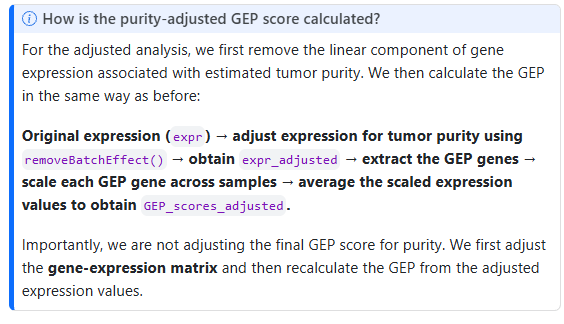

# RQ4 — The influence of tumor purity on immune-related biomarkers

How might differences in tumor purity influence the expression of immune- related biomarkers and their observed associations with treatment response? Suggested tasks:

-   Discuss how tumor purity may influence PD-1 expression and T-cell–inflamed GEP scores measured using bulk RNA-seq.

-   Consider whether differences in tumor purity could partly explain the associations observed in RQ2 and RQ3.

-   Discuss whether adjusting for tumor purity would necessarily improve the interpretation of these biomarkers.

## Part 1: Process data

```{r}

library(immunedeconv)
library(ggplot2)
library(limma)
library(pheatmap)
library(dplyr)
library(tidyr)

# Load datasets
counts <- readRDS("../data/counts.rds")
tpm <- readRDS("../data/tpm.rds")
clinical <- readRDS("../data/clinical.rds")
```

Quality check of data

```{r}
# Check whether all phenotype RNA IDs are represented in the expression matrix.
all(clinical$sample_id %in% colnames(counts))

# Reorder expression columns to match the phenotype table.
tpm <- tpm[, match(clinical$sample_id, colnames(tpm)), drop = FALSE]

# Explicitly verify the resulting sample order.
stopifnot(identical(clinical$sample_id, colnames(tpm)))

cat("Samples aligned:", ncol(tpm), "\n")
cat("Missing expression values:", sum(is.na(tpm)), "\n")

cat("\nResponse distribution:\n")
print(table(clinical$BOR, useNA = "ifany"))

#cat("\nPFS summary:\n")
#print(summary(pheno$PFS))
```

```{r}
#Helper functions week 6, but adjust color for box plot

plot_Response_boxplot <- function(data, variable, y_label, test_result) {

  # Keep response groups in the correct order
  data$Response <- factor(data$Response, levels = c("NR", "R"))

  # Count patients in each group
  n_per_group <- table(data$Response)

  # Descriptive response labels with patient counts
  group_labels <- c(
    NR = paste0(
      "Progressive disease (NR)\nn = ",
      n_per_group["NR"]
    ),
    R = paste0(
      "Complete response (R)\nn = ",
      n_per_group["R"]
    )
  )

  # Red = NR; blue = R
  group_colours <- c(
    NR = "#D9534F",
    R = "#2E86C1"
  )

  ggplot(
    data,
    aes(
      x = Response,
      y = .data[[variable]],
      fill = Response,
      colour = Response
    )
  ) +
    # Reference line at zero
    geom_hline(
      yintercept = 0,
      linetype = "dashed",
      colour = "grey60"
    ) +
    geom_boxplot(
      outlier.shape = NA,
      alpha = 0.25,
      width = 0.5
    ) +
    geom_jitter(
      width = 0.12,
      height = 0,
      alpha = 0.7,
      size = 2
    ) +
    annotate(
      "text",
      x = Inf,
      y = Inf,
      label = paste0(
        "Wilcoxon p = ",
        signif(test_result$p.value, 3)
      ),
      hjust = 1.1,
      vjust = 1.5,
      colour = "black"
    ) +
    scale_fill_manual(values = group_colours) +
    scale_colour_manual(values = group_colours) +
    scale_x_discrete(labels = group_labels) +
    labs(
      title = paste(y_label, "by treatment response"),
      subtitle = paste0(
        "Each dot is one patient; ",
        "dashed line = score 0"
      ),
      x = NULL,
      y = y_label
    ) +
    theme_minimal(base_size = 12) +
    theme(
      legend.position = "none",
      plot.title = element_text(face = "bold"),
      axis.text.x = element_text(colour = "black")
    )
}


plot_association <- function(data, x, y, x_label, y_label, cor_test) {
  rho <- unname(cor_test$estimate)

  ggplot(data, aes(x = .data[[x]], y = .data[[y]])) +
    geom_point(alpha = 0.7) +
    geom_smooth(method = "lm", se = FALSE) +
    annotate(
      "text",
      x = Inf, y = Inf,
      label = paste0(
        "Spearman rho = ", round(rho, 2),
        "\np = ", signif(cor_test$p.value, 3)
      ),
      hjust = 1.1, vjust = 1.3
    ) +
    labs(
      x = x_label,
      y = y_label
    ) +
    theme_minimal()
}
```

```{r}
TMB <- clinical$TMB

# Confirm that PDCD1 is present in the expression matrix.
"PDCD1" %in% rownames(counts)
```

```{r}
#PD1 : 
# Extract PDCD1 expression.
PD1 <- as.numeric(tpm["PDCD1", ])

summary(TMB)
```

```{r}
summary(PD1)
```

## Part 2: Results before adjusting for tumor purity

Calculate a T cell–inflamed gene-expression score from the supplied GEP gene set.

Step 1: Verify that the required genes are present

Step 2: Standardize each gene across samples (using scale()), and calculate the mean standardized expression for each sample.

```{r}
#Step 1:
GEP_genes <- c("TIGIT", "CD27", "CD8A", "PDCD1LG2", "LAG3", "CD274", "CXCR6", "CMKLR1", "NKG7", "CCL5", "PSMB10", "IDO1", "CXCL9", "HLA-DQA1", "CD276", "STAT1", "HLA-DRB1", "HLA-E", "PDCD1")


GEP_genes_present <- GEP_genes[GEP_genes %in% rownames(tpm)]
GEP_genes_missing <- setdiff(GEP_genes, rownames(tpm))

cat("GEP genes present:", length(GEP_genes_present), "of", length(GEP_genes), "\n")
```

```{r}
# Extract GEP genes.
GEP_expr <- log2(tpm[GEP_genes, , drop = FALSE] +1 )

#Step 2:
# Standardize each gene across samples.
# scale() operates on columns, so transpose before and after scaling.
GEP_expr_scaled <- t(scale(t(GEP_expr)))

# Average standardized expression across GEP genes for each sample.
GEP_scores <- colMeans(GEP_expr_scaled, na.rm = TRUE)

summary(GEP_scores)
```

Here we will make a dataframe for studying the association of biomarkers, TMB, PD1, and GEP_scores with a response class

```{r}
df <- data.frame(
  sample = clinical$sample_id,
  TMB = TMB,
  PD1 = PD1,
  GEP_scores = GEP_scores,
  Response = factor(clinical$BOR)
)

stopifnot(identical(df$sample, colnames(tpm)))

summary(df)

```

From the summary table, we know that we have 167 non-responders and 25 responders. We can see that TMB has 42 samples with NA

Next, we perform the Wilcox test, which is a non-parametric statistical test that uses rank values (good if data is not normally distributed)

```{r}
TMB_Response_test <- wilcox.test(TMB ~ Response, data = df)
PD1_Response_test <- wilcox.test(PD1 ~ Response, data = df)
GEP_Response_test <- wilcox.test(GEP_scores ~ Response, data = df)

TMB_Response_test
```

```{r}
PD1_Response_test
```

```{r}
GEP_Response_test
```

In the results of the Wilcox test, we can see that TMB, PD1, and GEP all have a p-value \< 0.05, which means that the result is statistically significant.

Now we plot the relationship between TMB and response class

```{r}
plot_Response_boxplot(df, "TMB", "Tumor mutational burden", TMB_Response_test)
```

```{r}
plot_Response_boxplot(df, "PD1", "PDCD1 expression", PD1_Response_test)
```

```{r}
plot_Response_boxplot(df, "GEP_scores", "T cell–inflamed GEP score", GEP_Response_test)
```

Above, we can see the distributions for the responders and non-responders for PD-1, GEP score, and TMB

## Part 3: Results Adjusted for Tumor Purity

Now we estimate the tumor purity using the deconvolute function. This is doon on the TPM-normalized data, which matches the genes to a dataset; we have 139 genes that overlap with the StromalSignature and 141 with ImmuneSignature.

```{r}
#5. Estimate tumor purity
purity <- deconvolute_estimate(tpm)
```

```{r}
class(purity)
```

```{r}
dim(purity)
```

```{r}
rownames(purity)
```

```         
StromalScore: Higher values indicate greater stromal cell presence (e.g., fibroblasts, endothelial cells) in the tumor microenvironment.
ImmuneScore: Higher values indicate greater immune cell infiltration.
ESTIMATEScore: Composite measure of total non-tumor cellular admixture; higher values mean lower tumor purity.
TumorPurity:  Estimated proportion (0 to 1) of malignant tumor cells in the sample.
```

```{r}
# The ESTIMATE output contains a tumor-purity row.
# Inspect row names before extracting it rather than relying only on row position.
purity_row <- grep("purity", rownames(purity), ignore.case = TRUE, value = TRUE)

if (length(purity_row) != 1) {
  stop("Could not identify exactly one tumor-purity row in the ESTIMATE output.")
}

tumor_purity <- as.numeric(purity[purity_row, ])

# Preserve the sample identifiers supplied by the deconvolution result.
names(tumor_purity) <- colnames(purity)

# Reorder purity to match the expression/phenotype sample order.
tumor_purity <- tumor_purity[colnames(tpm)]

stopifnot(identical(names(tumor_purity), colnames(tpm)))
stopifnot(length(tumor_purity) == nrow(df))

summary(tumor_purity)
```

Here we can see that the sample that is estimated to be the most pure is 96 % pure, and the least pure is 30 % pure

```{r}
df$purity <- tumor_purity
```

### Correlation between tumor purity and biomarkers

```{r}
#How strongly are the biomarkers related to tumor purity?
# For this test, the Spearman correlation is used as it does not assume a normal distribution
TMB_purity_cor <- cor.test(
  df$purity, df$TMB,
  method = "spearman",
  exact = FALSE,
  use = "complete.obs"
)

PD1_purity_cor <- cor.test(
  df$purity, df$PD1,
  method = "spearman",
  exact = FALSE,
  use = "complete.obs"
)

GEP_purity_cor <- cor.test(
  df$purity, df$GEP_scores,
  method = "spearman",
  exact = FALSE,
  use = "complete.obs"
)

TMB_purity_cor
```

There is no statistically significant relationship between TMB and the predicted tumor purity

```{r}
PD1_purity_cor
```

There is a statistically significant relationship between PD1 and the predicted tumor purity

```{r}
GEP_purity_cor
```

There is a significant relationship between GEP score and the predicted tumor purity

```{r}
plot_association(
  df, "purity", "TMB",
  "Tumor purity", "Tumor mutational burden", TMB_purity_cor
)
```

```{r}
plot_association(
  df, "purity", "PD1",
  "Tumor purity", "PD1 expression", PD1_purity_cor
)
#"PDCD1 expression"
```

```{r}
plot_association(
  df, "purity", "GEP_scores",
  "Tumor purity", "T cell–inflamed GEP score", GEP_purity_cor
)
```

### Results where expression is adjusted for tumor purity Wilcox test and Box-plots

Note from week 6:



#### Whit log2 trasformation

```{r}
expr_adjusted <- removeBatchEffect(
  tpm,
  covariates = matrix(df$purity, ncol = 1)
)

PD1_adjusted <- log2(as.numeric(expr_adjusted["PDCD1",  , drop = FALSE] +1 ))

GEP_expr_adjusted <- log2(expr_adjusted[
  GEP_genes_present,
  , drop = FALSE] +1
)

GEP_expr_adjusted_scaled <- t(scale(t(GEP_expr_adjusted)))
GEP_scores_adjusted <- colMeans(
  GEP_expr_adjusted_scaled,
  na.rm = TRUE
)

df_adjusted <- data.frame(
  sample = clinical$sample_id,
  PD1 = PD1_adjusted,
  GEP_scores = GEP_scores_adjusted,
  Response = factor(clinical$BOR)
)

stopifnot(identical(df_adjusted$sample, colnames(expr_adjusted)))
```

```{r}
PD1_Response_adjusted_test <- wilcox.test(PD1 ~ Response, data = df_adjusted)
GEP_Response_adjusted_test <- wilcox.test(GEP_scores ~ Response, data = df_adjusted)


PD1_Response_adjusted_test
```

```{r}
GEP_Response_adjusted_test
```

```{r}
plot_Response_boxplot(
  df_adjusted, "PD1",
  "Purity-adjusted PDCD1 expression (log2)",
  PD1_Response_adjusted_test
)
```

```{r}
plot_Response_boxplot(
  df_adjusted, "GEP_scores",
  "Purity-adjusted T cell–inflamed GEP score (log2) ",
  GEP_Response_adjusted_test
)
```

#### Not log2 transformed

```{r}
expr_adjusted <- removeBatchEffect(
  tpm,
  covariates = matrix(df$purity, ncol = 1)
)

PD1_adjusted <- as.numeric(expr_adjusted["PDCD1", ])

GEP_expr_adjusted <- expr_adjusted[
  GEP_genes_present,
  ,
  drop = FALSE
]

GEP_expr_adjusted_scaled <- t(scale(t(GEP_expr_adjusted)))
GEP_scores_adjusted <- colMeans(
  GEP_expr_adjusted_scaled,
  na.rm = TRUE
)

df_adjusted <- data.frame(
  sample = clinical$sample_id,
  PD1 = PD1_adjusted,
  GEP_scores = GEP_scores_adjusted,
  Response = factor(clinical$BOR)
)

stopifnot(identical(df_adjusted$sample, colnames(expr_adjusted)))
```

```{r}
PD1_Response_adjusted_test <- wilcox.test(PD1 ~ Response, data = df_adjusted)
GEP_Response_adjusted_test <- wilcox.test(GEP_scores ~ Response, data = df_adjusted)


PD1_Response_adjusted_test
```

```{r}
GEP_Response_adjusted_test
```

```{r}
plot_Response_boxplot(
  df_adjusted, "PD1",
  "Purity-adjusted PDCD1 expression",
  PD1_Response_adjusted_test
)
```

```{r}
plot_Response_boxplot(
  df_adjusted, "GEP_scores",
  "Purity-adjusted T cell–inflamed GEP score ",
  GEP_Response_adjusted_test
)
```

### Heatmap of the immune-adjusted expression of GEP genes

```{r}
GEP_expression <- log2(expr_adjusted[GEP_genes, , drop = FALSE] +1 )
dim(GEP_expression) # 192 patients

# Checking expression
# per gene
summary(t(GEP_expression))


```

```{r}
annotation <- data.frame(Response = clinical$BOR,
                         row.names = clinical$sample_id)
annotation_colors <- list(
  Response = c(
    "NR" = "#D9534F",  # Red
    "R"  = "#2E86C1"   # Blue
  )
)

ord <- order(clinical$BOR)

pheatmap(
  GEP_expression[, ord, drop = FALSE],
  scale = "row",
  annotation_col = annotation[ord, , drop = FALSE],
  annotation_colors = annotation_colors,
  color = colorRampPalette(c("#D8B365", "white", "#542788"))(100),
  cluster_cols = FALSE,
  show_colnames = FALSE,
  main = "GEP gene expression according to response group"
)
```

```{r}
#same heatmap data as above just diffrinft format and scaing:

# color scale
heatmap_colours <- colorRampPalette(
  c("#D8B365", "white", "#542788")
)(100)

#########################
# gene expression heatmap
#########################

# standardize each gene across patients
GEP_heatmap_scaled <- t(scale(t(GEP_expression)))

# order patients by response (NR --> R)
ord <- order(factor(clinical$BOR, levels = c("NR", "R")))
GEP_heatmap_scaled <- GEP_heatmap_scaled[, ord]

# long format (one row per gene-patient combo)
heatmap_df <- as.data.frame(as.table(GEP_heatmap_scaled))
colnames(heatmap_df) <- c("Gene", "Sample", "Expression")

# keep patient order and display genes in panel order
heatmap_df$Sample <- factor(heatmap_df$Sample,
                            levels = colnames(GEP_heatmap_scaled))
heatmap_df$Gene <- factor(heatmap_df$Gene,
                          levels = rev(rownames(GEP_heatmap_scaled)))

# group sizes (for split line + labels)
n_NR <- sum(clinical$BOR == "NR")
n_R  <- sum(clinical$BOR == "R")

# symmetric limits keep white at z-score 0
z_max <- max(abs(heatmap_df$Expression))

ggplot(heatmap_df, aes(x = Sample, y = Gene, fill = Expression)) +
  geom_tile() +
  geom_vline(xintercept = n_NR + 0.5, linetype = "solid",
             color = "black", linewidth = 0.8) +
  annotate("text", x = n_NR / 2, y = -Inf,
           label = paste0("NR (n = ", n_NR, ")"),
           vjust = 1.8, fontface = "bold") +
  annotate("text", x = n_NR + n_R / 2, y = -Inf,
           label = paste0("R (n = ", n_R, ")"),
           vjust = 1.8, fontface = "bold") +
  scale_fill_gradientn(colours = heatmap_colours,
                       limits = c(-z_max, z_max),
                       name = "Gene-wise\nz-score") +
  coord_cartesian(clip = "off") +
  labs(title = "Gene wise expression of the 19 GEP genes",
       x = "Patients ordered by response", y = NULL) +
  theme_minimal() +
  theme(axis.text.x = element_blank(),
        axis.title.x = element_text(margin = margin(t = 30)),
        panel.grid = element_blank(),
        plot.title = element_text(hjust = 0.5, face = "bold"),
        plot.margin = margin(10, 5.5, 10, 5.5))
```

### Test if there is a difference in the predicted composition of immune cells between responders and non-responders

##### Including uncharacterized cells

```{r}
# Make sure tpm is a matrix
tpm_mat <- as.matrix(tpm)

# Run immune cell deconvolution
res <- immunedeconv::deconvolute(
  tpm_mat,
  "quantiseq",
  tumor = TRUE
)

# Display results
knitr::kable(res, digits = 2)
#In the table below, we see the predicted cell type pr. sampel
```

```{r}
# Convert deconvolution output to long format
res_long <- res %>%
  pivot_longer(
    cols = -cell_type,
    names_to = "sample_id",
    values_to = "fraction"
  )
```

```{r}
clinical_response <- clinical %>%
  select(sample_id, BOR)

# Join the clinical information to the immune cell data
res_clinical <- res_long %>%
  left_join(clinical_response, by = "sample_id")
```

```{r}
# these are the data in long format
table(res_clinical$BOR, useNA = "ifany")
```

Test that the longer worked (it did because each sample became 11 rows)

```{r}
1837/167
275/25
```

The geometrix mean for each immune cell in each call is calculated per response group.

```{r}
#
gm_results <- res_clinical %>%
  group_by(BOR, cell_type) %>%
  summarise(
    gm = if (any(fraction == 0, na.rm = TRUE)) {
      0
    } else {
      exp(mean(log(fraction), na.rm = TRUE))
    },
    .groups = "drop"
  )
gm_results <- gm_results %>%
  group_by(BOR) %>%
  mutate(
    percentage = gm / sum(gm) * 100
  ) %>%
  ungroup()
```

```{r}
gm_results <- gm_results %>%
  group_by(BOR) %>%
  mutate(
    percentage = gm / sum(gm) * 100
  ) %>%
  ungroup()
```

```{r}
gm_results

gm_results %>%
  group_by(BOR) %>%
  summarise(total = sum(percentage))
```

```{r}
ggplot(gm_results, aes(x = BOR, y = percentage, fill = cell_type)) +
  geom_col() +
  labs(
    title = "Immune cell composition by BOR",
    y = "Relative immune cell composition (%)",
    fill = "Cell type"
  ) +
  theme_bw()
```

##### Excluding uncharacterized cells

```{r}
gm_results <- res_clinical %>%
  filter(cell_type != "uncharacterized cell") %>%
  group_by(BOR, cell_type) %>%
  summarise(
    gm = if (any(fraction == 0, na.rm = TRUE)) {
      0
    } else {
      exp(mean(log(fraction), na.rm = TRUE))
    },
    .groups = "drop"
  )

gm_results <- gm_results %>%
  group_by(BOR) %>%
  mutate(
    percentage = gm / sum(gm) * 100
  ) %>%
  ungroup()

ggplot(gm_results, aes(x = BOR, y = percentage, fill = cell_type)) +
  geom_col() +
  labs(
    title = "Immune cell composition by BOR",
    x = "Best Overall Response",
    y = "Relative immune cell composition (%)",
    fill = "Cell type"
  ) +
  theme_bw()
```

This is not a statsical test / annlyis, more analyses woud need to folow to prove this relationship, but there is an indication that there is a difference in the compostion of imune celles betwen responce and non responders, spicetion in the presees of M2 macophages which, dont seam to dominatet at the non respondes
